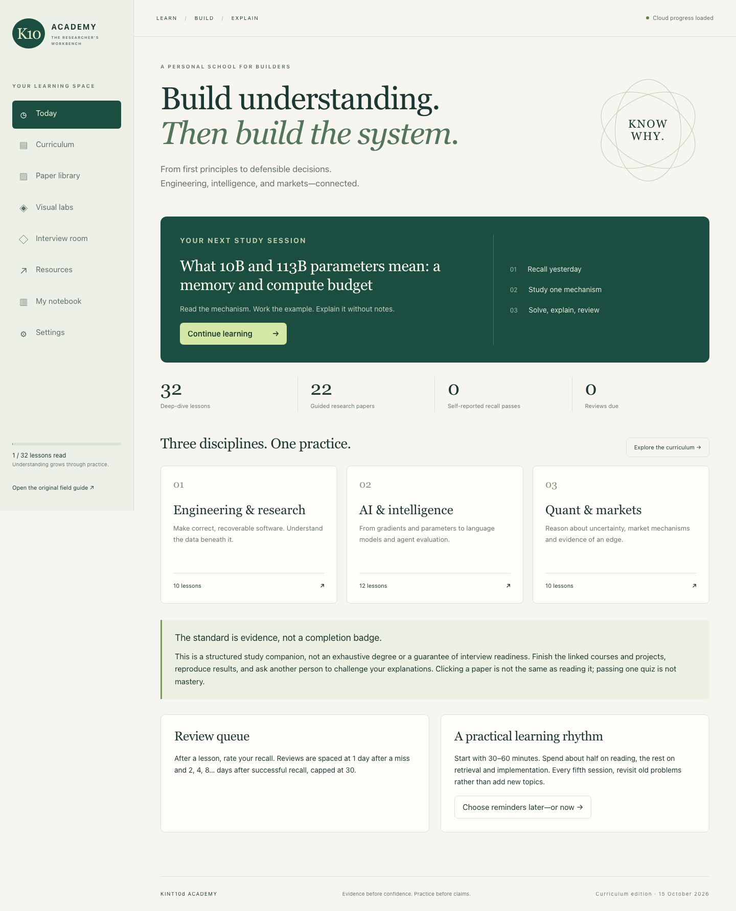
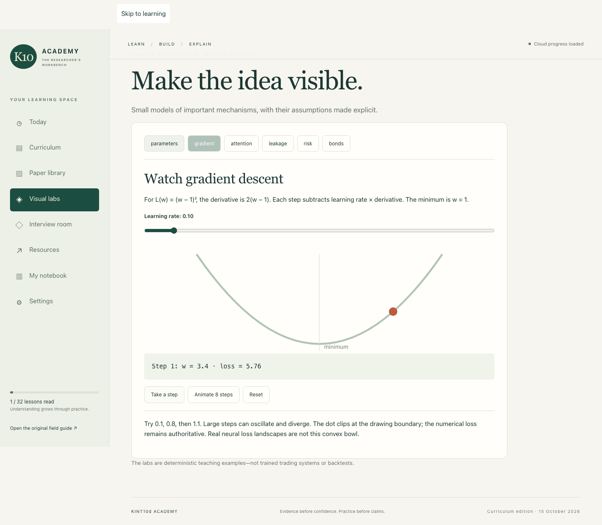

# KINT10d Academy

A learning studio connecting **software engineering, artificial intelligence, and quantitative research**. Read a mechanism, work an example, explain it without notes, and return for spaced review.

Built as an AI-assisted portfolio project. The focus is observable learning progress and defensible engineering—not a claim of trading profitability or automatic mastery.

## Features

- **32 deep-dive lessons** with worked exercises, interview answers and concept checks.
- **22 guided research papers** and **77 linked courses, videos, books and documentation resources**.
- **Six interactive labs:** parameter memory, gradient descent, attention, leakage, losing streaks and bond pricing.
- Account-scoped notes, reading states, section bookmarks and recall review dates.
- Optimistic concurrency: stale device writes receive a conflict instead of overwriting newer progress.
- Browser-retained unsynced note drafts and JSON exports.
- Responsive desktop, tablet and phone layouts; web-app manifest.
- User-selected recurring calendar reminders.
- Downloadable deep-study book and the original 36-chapter field guide.

**No broker connection, order placement, paid model calls or trading credentials are included.** The personal deployment remains private; this repository contains public source and illustrative curriculum.

## Run locally

Requires **Node.js 24**, npm and a modern browser. No API keys are required.

~~~bash
git clone https://github.com/Karthikeyavvsr/kint10d-academy.git
cd kint10d-academy
npm ci
npm run build
npm run db:local
npm run dev -- --hostname 127.0.0.1
~~~

Open **http://127.0.0.1:5173** and select **Sign in with ChatGPT**. On loopback development only, the supplied starter simulates a test identity. This is a local test login, not real OAuth.

The first build generates local Worker configuration. The migration command applies pending schema changes without erasing progress. Data stays in ignored .wrangler/state; deleting that directory deletes local progress. The production start command serves a built Worker without simulated login.

## Verify

~~~bash
npm run typecheck
npm run test:content
npm run build
npm run db:local
npx playwright install chromium
~~~

With the development server running in another terminal:

~~~bash
npm run test:e2e
~~~

On Linux, browser dependencies can be installed with:

~~~bash
npx playwright install --with-deps chromium
~~~

The suite checks login, persisted notes and reading state, a second simulated device, stale-write rejection, invalid input, unauthorized access, mobile overflow, lab arithmetic and calendar export. It writes test progress to the local test account.

GitHub Actions runs the same checks. Simulated-device tests do not prove physical iOS alert delivery or replace a production security review.

## Architecture

~~~mermaid
flowchart LR
    UI["React reader and visual labs"] --> API["Authenticated progress API"]
    API --> DB["D1: owner + key + revision"]
    UI --> Draft["Device-local unsynced drafts"]
    UI --> Content["Versioned curriculum and paper guides"]
    UI --> Calendar["User-imported calendar reminder"]
    Edge["Trusted hosting identity boundary"] --> API
~~~

| Area | Implementation |
| --- | --- |
| UI | React 19, TypeScript, CSS, Vinext / Vite |
| Server | Worker-compatible route handlers |
| Storage | Cloudflare D1, Drizzle schema and SQL migration |
| Identity | Sites dispatch in production; loopback-only mock in development |
| Sync | Per-record revision checks and explicit conflict recovery |
| Content | Versioned JSON and downloadable HTML/Markdown |
| Quality | Type checking, content checks, Playwright, GitHub Actions |

See [architecture](docs/ARCHITECTURE.md), [content editing](docs/CONTENT.md), [security](SECURITY.md) and [contributing](CONTRIBUTING.md).

## Source map

| Path | Purpose |
| --- | --- |
| app/ | Reader, labs, content and progress API |
| db/, drizzle/ | Database schema and migration |
| content-*.json | Authored curriculum and papers |
| public/ | Offline books, icons, manifest, service worker |
| qa/ | Browser and content checks |
| scripts/ | Build/runtime helpers and local migrations |
| docs/ | Architecture, content guide and screenshots |
| build/, vendor/ | Retained starter integration and notices |

## Deployment and identity boundary

The personal deployment uses **Sites** authentication and a private audience. Its project ID, credentials, database and Git history are absent here.

For another Sites deployment, register your own project and configure its D1 binding. The public hosting manifest declares logical storage only.

**Do not expose the Worker directly to the internet while trusting caller-supplied identity headers.** Production depends on a trusted hosting gateway authenticating visitors and controlling the oai-authenticated-user headers. Another platform needs an audited session/authentication adapter and protected ingress. Local mock authentication must never become public authentication.

## Limits and next steps

- Reading, quiz results and self-reported recall are distinct. None certifies expertise.
- Spaced review is a simple heuristic, not a validated personalized learning model.
- New page loads fetch cloud progress. Already-open devices can reload it in Settings.
- Private pages are not cached offline. Downloaded books work offline but do not sync.
- Background web push is **not implemented**. A user must import the calendar event and verify its alert.
- Paper guides are orientation and reproduction prompts, not claims of independent reproduction.
- Finance examples are educational. A backtest alone does not establish an executable edge.
- This curriculum complements courses, implementation practice and expert feedback.

## Portfolio discussion points

Explain ownership predicates, compare-and-swap revisions, why a draft is not a successful sync, why model memory exceeds weight storage, and why a backtest must enforce information availability.

The project was designed and iterated with AI assistance. Its value as a portfolio piece comes from understanding, testing and extending the implementation—not presenting generated work as independently authored expertise.

## License

Original code and original curriculum are [MIT licensed](LICENSE). Retained third-party components keep their notices: [THIRD_PARTY_NOTICES.md](THIRD_PARTY_NOTICES.md). Linked papers and courses are not relicensed or redistributed.

## Native Apple application

The [SwiftUI app](native/README.md) supports iPhone, iPad and Mac with offline lessons, native visual labs, reading progress, pace estimates, themes, notes and opt-in reminders. The [private sync backend](native-sync/README.md) runs on Railway for the owner; deployment instructions are included for other users. Native and web account sessions are separate; progress can be transferred through JSON export/import.
