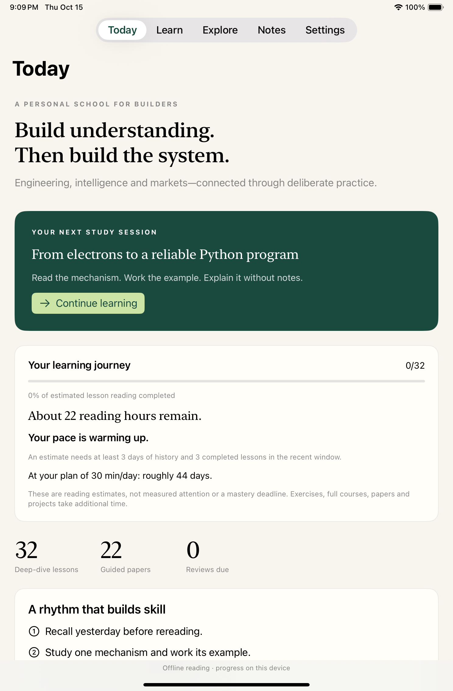

# KINT10d Academy — native Apple app

SwiftUI reader for iPhone, iPad and Mac. This is a native app with bundled curriculum, Swift Charts labs and local progress—not a website wrapper.

## Included

- 32 deep lessons, 22 guided research papers, 77 linked resources, six interactive labs.
- Reading progress, estimated hours remaining, a configurable daily plan and a rolling pace estimate.
- Bookmarks, notes, quizzes, self-reported recall and spaced review.
- System/Light/Dark themes, system font scaling, reader text adjustment, native tabs on iOS and sidebar on Mac.
- Opt-in device-local reminders. No notification prompt or schedule on launch.
- Offline atomic saves, JSON import/export, optional user-selected iCloud Drive folder and an authenticated Railway-compatible sync client.

The original web app remains available. Website account sessions are separate; export saved progress as JSON, then import it here. Drafts are not imported. A private instance of the cloud service is deployed on Railway. Its pairing key is not part of this repository.

## Build

Use Xcode with the iOS 17+ and macOS 14+ SDKs. The checked-in Xcode project can be opened directly. To regenerate it after source changes, install XcodeGen and run `xcodegen generate` in this directory.

```sh
swift test --package-path Core
xcodebuild -project KINT10dAcademy.xcodeproj -scheme AcademyMac -configuration Debug CODE_SIGNING_ALLOWED=NO build
xcodebuild -project KINT10dAcademy.xcodeproj -scheme AcademyiOS -sdk iphonesimulator CODE_SIGNING_ALLOWED=NO build
```

For a physical iPhone or iPad:

1. Open `KINT10dAcademy.xcodeproj` in Xcode and select **AcademyiOS**.
2. In Signing & Capabilities select your own Personal Team. If necessary choose a unique bundle identifier. Do not commit personal signing settings.
3. Connect and trust the device; enable Developer Mode when iOS requests it.
4. Select the device as the run destination and run. Handle Apple account/password prompts yourself.
5. Free Personal Team provisioning is for personal development, expires and requires periodic reinstallation. Paid membership is needed for normal distribution. Never remove the app to renew a build without exporting progress first.

The intended personal devices are iPhone 17 Pro and iPad mini. Simulator verification does not establish physical-device notification, signing or accessibility behavior. Native glass appearance follows the installed OS; older supported OS versions use their standard materials.

## Progress and pace

The bar weights completed lessons by their estimated reading minutes. It is a **first reading pass**, not a mastery score. Papers, courses and exercises are additional work.

Planned days = remaining estimated minutes / chosen daily minutes. Observed days = remaining minutes / recent estimated minutes completed per calendar day. The observed window is up to 14 days, includes days without completions, and requires at least three days of history and three recent completed lessons. It measures marked completions, not attention or time spent. Imported/changed completion timestamps and inaccurate device clocks affect the estimate.

## Sync and recovery

Local saves are atomic. Cloud sync is optional, triggered by edits and app activation. A failed sync retains local changes and shows a pending state. A server-wide revision protects against stale writes; clients fetch and merge on conflicts. Per-record latest timestamp wins; equal timestamps use a deterministic value tie-break. Simultaneous edits to the **same note** are not collaborative text merging. Export progress before imports or major edits; keep automatic device time enabled.

Use Settings → Shared progress to enter the deployed HTTPS origin and private pairing key. Credentials are stored in the device Keychain, never bundled. This is a private single-owner service, not a public multi-user login product. Anyone holding the pairing key can access or change that owner's notes/progress. See [backend setup](../native-sync/README.md).

Alternatively choose the same dedicated iCloud Drive folder on each device. Each device writes its own snapshot; other files are preserved. File-provider delivery can be delayed. No CloudKit capability is claimed. Use one preferred sync mechanism to reduce confusion.

Reminders are local to each device. Focus modes, notification permissions and OS delivery rules apply. The app does not need a server to remind you. Screen Time monitoring and Dynamic Island characters are deliberately deferred.

## Design and learning rationale

[Design sources and limitations](DESIGN.md). [Verification record](VERIFICATION.md).

## Simulator previews



[Light iPhone](../docs/images/native-phone.png) · [Dark iPhone](../docs/images/native-phone-dark.png)
